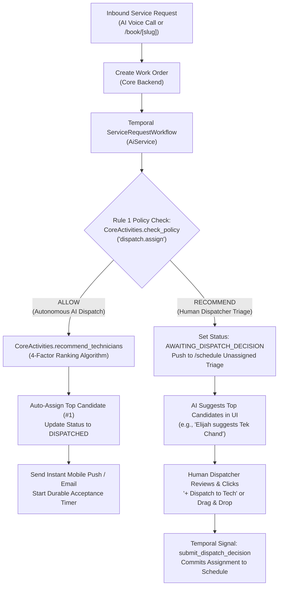
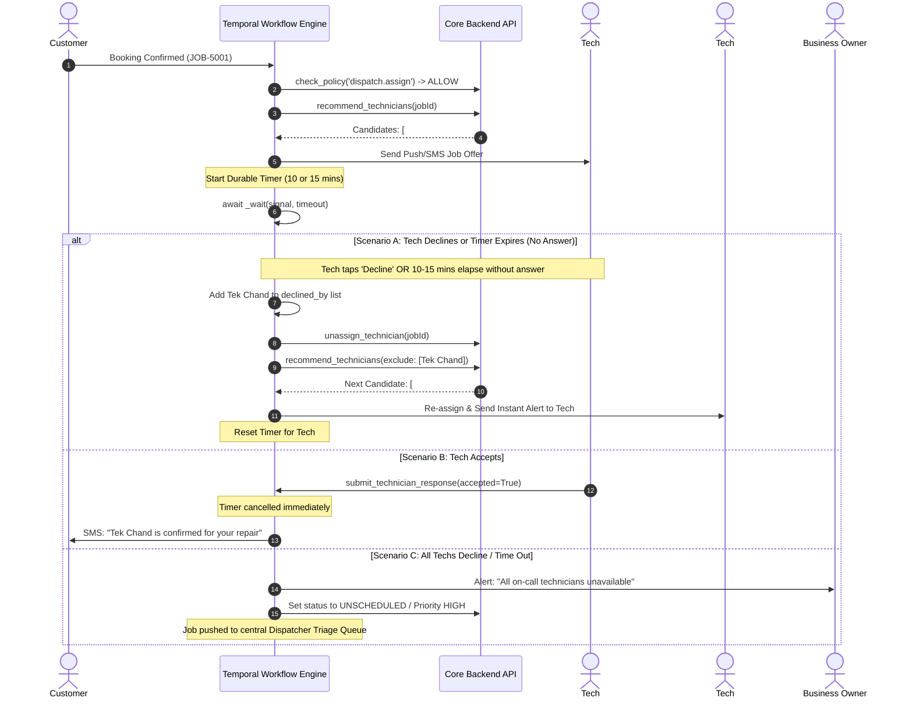

# Elijah AI — Autonomous vs. Manual Dispatch Architecture Guide
**Rule 1: The Company Dispatch Policy (`dispatch.assign`), Acceptance Timers & Autonomous Escalation**

> **Official Developer Reference for Core Backend & AI Service Teams**  
> Location: `backend/DISPATCH_MANUAL_VS_AUTOMATED_GUIDE.md`  
> Authoritative guide for: Core Backend Engineers, AI/Workflow Engineers, and Front-End Teams.

---

## 1. Executive Summary

Elijah AI supports two operational models configured by each contractor in their **Company Settings (`/settings`)**:

1. **100% Autonomous AI Contractor:** Operates with zero human dispatcher overhead. Inbound bookings from AI phone calls or the public booking website immediately evaluate technician trade skills, distance, and current workload, assign the #1 ranked technician, and monitor acceptance via durable timers.
2. **Hybrid Service Company:** Employs human dispatchers who want AI-calculated candidate rankings and scoring hints, but require a human dispatcher to review and approve work orders from an **Unassigned Triage Queue** on the Schedule Board.



---

## 2. Where Rule 1 is Defined & Checked in the Codebase

Rule 1 is evaluated across three layers:

### Layer A: Temporal Workflow Engine (`AiService`)
- **File:** [`AiService/services/workflow-service/app/workflows/service_request.py`](file:///d:/PODS/ElijahAi/AiService/services/workflow-service/app/workflows/service_request.py#L238-L270)
- **Code:**
```python
async def _dispatch_standard(self) -> bool:
    # 1. Evaluate Rule 1: The Company Dispatch Policy
    decision = await self._run(
        CoreActivities.check_policy,
        PolicyInput(context=self._context(), action="dispatch.assign"),
    )
    auto_attempts = MAX_AUTO_ASSIGN_ATTEMPTS if decision == "ALLOW" else 0

    while True:
        # 2. Rank available qualified technicians
        candidates = await self._run(
            CoreActivities.recommend_technicians,
            JobInput(context=self._context(), job_id=self._job_id),
        )
        declined = {technician.id for technician in self._state.declined_by}
        candidates = [c for c in candidates if c.technician.id not in declined]
        self._state.candidates = candidates

        if not candidates:
            self._record("no_candidates", "No qualified technician is free in that window")
            return False

        if auto_attempts > 0:
            # MODE A: Autonomous AI Dispatch (ALLOW)
            auto_attempts -= 1
            best = candidates[0]
            choice = best.technician.id
            self._record(
                "auto_assign",
                f"Elijah chose {best.technician.name}, the best free technician ({best.why})",
            )
        else:
            # MODE B: Human Dispatcher Triage (RECOMMEND)
            choice = await self._await_dispatch_decision(
                ServiceRequestStatus.AWAITING_DISPATCH_DECISION, candidates[0].technician.name
            )

        if await self._try_assign(choice):
            return True
```

### Layer B: Core Activities HTTP Bridge (`AiService`)
- **File:** [`AiService/services/workflow-service/app/activities/core_activities.py`](file:///d:/PODS/ElijahAi/AiService/services/workflow-service/app/activities/core_activities.py#L218-L225)
- **Code:**
```python
@activity.defn(name="check_policy")
async def check_policy(self, data: PolicyInput) -> str:
    body: dict[str, Any] = {"action": data.action}
    if data.amount_cents is not None:
        body["amountCents"] = data.amount_cents
    result = await self._call("POST", "/internal/v1/policy/check", data.context, json=body)
    return str(result["decision"])
```

### Layer C: Policy Enforcement & Tenant Settings Engine (`backend`)
- **File:** [`backend/src/modules/internal/internal.controller.ts`](file:///d:/PODS/ElijahAi/backend/src/modules/internal/internal.controller.ts#L330-L352)
- **Endpoint:** `POST /internal/v1/policy/check`
- **Code:**
```typescript
static async checkPolicy(req: InternalRequest, res: Response) {
  const { action, amountCents } = req.body || {};
  const tenantId = req.tenantId || 'cmwg840lc0001yeczrxxdxt6r';
  const settings = TenantSettingsService.getSettings(tenantId);

  // Rule 1: The Company Dispatch Policy (dispatch.assign)
  // ALLOW -> Autonomous AI Dispatch (Assign top candidate)
  // RECOMMEND -> Dispatcher Triage Queue (Awaiting manual decision)
  if (action === 'dispatch.assign') {
    const decision = settings.dispatchPolicy || 'ALLOW';
    return res.json({ data: { decision } });
  }

  // Rule 2: Invoice Approval Threshold (invoice.send)
  if (action === 'invoice.send') {
    const limitCents = (settings.invoiceApprovalThreshold || 5000) * 100;
    if (amountCents && amountCents > limitCents) {
      return res.json({ data: { decision: 'REQUIRE_APPROVAL' } });
    }
    return res.json({ data: { decision: 'APPROVE' } });
  }

  return res.json({ data: { decision: 'ALLOW' } });
}
```

---

## 3. Technician Acceptance Time Frames & Timeout Limits

When an assignment is dispatched autonomously, the system enforces strict time windows for the technician to acknowledge and confirm the work order:

| Workflow Scenario | Time Window | Configuration Parameter | Source Code Definition | Where Configured |
| :--- | :--- | :--- | :--- | :--- |
| **🚨 Emergency On-Call Page** | **10 minutes** (600 s) | `on_call_accept_timeout_seconds` | `core/config.py` line 39 | **Company Settings (`/settings`)** under *"Emergency Page Timeout"* |
| **📋 Standard Daytime Appointment** | **15 minutes** (900 s) | `technician_accept_timeout_seconds` | `core/config.py` line 42 | Default configuration in `workflow-service` |
| **👤 Human Dispatcher Reminder** | **30 minutes** (1,800 s) | `dispatch_reminder_seconds` | `core/config.py` line 40 | Escalation reminder if an unassigned triage job sits idle |

---

## 4. How the AI Checks and Enforces Timeouts (Event-Driven vs. Polling)

The platform does **NOT** use busy-waiting or thread-blocking loops. Instead, it relies on **Temporal Durable Workflow Timers** and **Event Signals**:



### Detailed Workflow Timer Implementation:
In [`AiService/services/workflow-service/app/workflows/service_request.py`](file:///d:/PODS/ElijahAi/AiService/services/workflow-service/app/workflows/service_request.py#L310-L327):

```python
async def _await_technician_acceptance(self) -> bool:
    technician = self._state.technician
    if technician is None:
        return False

    self._set_status(ServiceRequestStatus.AWAITING_TECHNICIAN_ACCEPTANCE)
    await self._message_technician(technician.id, "technician_job_offer", "sms")
    self._record("offered", f"Offered to {technician.name}; waiting for them to accept")

    # 1. Setup durable timer from input timings
    timeout = timedelta(seconds=self._input.timings.technician_accept_timeout_seconds)

    # 2. Wait asynchronously for technician response signal
    if not await self._wait(lambda: self._find_response(technician) is not None, timeout):
        # TIMER EXPIRED: Technician did not answer within timeout window
        await self._release_technician(technician, "did not answer in time")
        return False

    # 3. Technician provided a response
    response = self._take_response(technician)
    if response.accepted:
        self._record("accepted", f"{technician.name} accepted the job")
        return True

    # Technician explicitly declined
    await self._release_technician(technician, response.reason or "declined")
    return False
```

### The Technician Release and Re-Ranking Loop:
```python
async def _release_technician(self, technician: TechnicianRef, reason: str) -> None:
    # 1. Unassign from database
    await self._run(CoreActivities.unassign_technician, JobInput(context=self._context(), job_id=self._job_id))
    # 2. Add to exclusion blacklist for this job
    self._state.declined_by.append(technician)
    self._record("technician_released", f"{technician.name} released the job: {reason}")
    # 3. Alert dispatchers in real time
    await self._message_role("dispatcher", "technician_declined", technician=technician.name, reason=reason)
```

In [`_find_confirmed_technician`](file:///d:/PODS/ElijahAi/AiService/services/workflow-service/app/workflows/service_request.py#L228-L236):
```python
while True:
    if not assigned:
        await self._wait_for_manual_assignment()
    if await self._await_technician_acceptance():
        return
    # If not accepted, re-rank excluding all declined technicians and dispatch again!
    assigned = await self._dispatch_standard()
```

---

## 5. Direct Mobile Field App Decline (`/api/v1/jobs/:id/decline`)

In addition to Temporal signals, technicians using the **Mobile Field App** ([`company-frontend/src/app/(dashboard)/tech/page.tsx`](file:///d:/PODS/ElijahAi/company-frontend/src/app/(dashboard)/tech/page.tsx)) can tap **"Decline Job"**:

1. Mobile app fires `POST /api/v1/jobs/:id/decline` with `{ reason: '...' }`.
2. Core Backend runs [`JobService.declineJob`](file:///d:/PODS/ElijahAi/backend/src/modules/jobs/job.service.ts#L363-L501):
   - Appends `[Declined by <TechName> (Reason: ...)]` to the job notes.
   - Queries `prisma.user.findMany` for active certified technicians in the tenant.
   - Filters out all technicians who have previously declined.
   - Sorts candidates by lowest active workload (`activeCount`).
   - Automatically reassigns to the next best technician, updates the status to `DISPATCHED`, sends an email alert, and pushes real-time Server-Sent Events (SSE) to the Schedule Board.
   - If no other technician is available, it escalates the work order to `UNSCHEDULED` / priority `HIGH` in the dispatcher triage queue.

---

## 6. What Happens When a Customer Books Manually (Online `/book` or Dispatcher)?

| Booking Method | Mode in `/settings` | Job Status | Assigned To | Where it Appears |
| :--- | :--- | :--- | :--- | :--- |
| **Customer Online Form** | **Autonomous (`ALLOW`)** | `DISPATCHED` | Auto-assigned to top technician | Direct in technician's swimlane on `/schedule` + email/push alert |
| **Customer Online Form** | **Triage (`RECOMMEND`)** | `UNSCHEDULED` | `null` | In the **Unassigned Triage Queue** banner at top of `/schedule` |
| **Dispatcher "+ Book Order"** | Technician selected | `DISPATCHED` | Selected technician | In that technician's swimlane |
| **Dispatcher "+ Book Order"** | Left as Unassigned | `UNSCHEDULED` | `null` | In the **Unassigned Triage Queue** banner at top of `/schedule` |

---

## 7. The 4-Factor Technician Ranking Algorithm

When `CoreActivities.recommend_technicians` runs, it calls `GET /internal/v1/jobs/:jobId/technician-recommendations` on the core backend ([`backend/src/modules/internal/internal.service.ts`](file:///d:/PODS/ElijahAi/backend/src/modules/internal/internal.service.ts#L377-L413)).

Candidates are evaluated and sorted based on:

1. **Trade Skills & Certification:** Must match the work order trade (`HVAC`, `PLUMBING`, `ELECTRICAL`, `ROOFING`).
2. **Geographic Proximity & Drive Time:** Distance from technician's last known location to customer address.
3. **Current Workload & Active Daily Load:** Technicians with `0` active jobs today receive priority over technicians with 3+ jobs.
4. **Customer Rating & Repeat History:** Technicians with 5-star ratings or previous positive customer reviews receive an affinity bonus.

---

## 8. Where Contractors Configure Operational Mode

Contractors configure this directly in **Company Settings (`/settings`)**:

- **UI Location:** [`company-frontend/src/app/(dashboard)/settings/page.tsx`](file:///d:/PODS/ElijahAi/company-frontend/src/app/(dashboard)/settings/page.tsx#L490-L650)
- **API Endpoints:**
  - `GET /api/v1/auth/company-settings` (reads active company settings)
  - `PATCH /api/v1/auth/company-settings` (saves mode toggle & thresholds)
- **Storage Layer:** [`backend/src/services/tenantSettings.service.ts`](file:///d:/PODS/ElijahAi/backend/src/services/tenantSettings.service.ts) persisted in `backend/data/tenant_settings.json`.

---

## 9. Verification & Testing

### 1. Test Policy Check via cURL / Node
```bash
node -e "fetch('http://localhost:5000/internal/v1/policy/check', {
  method: 'POST',
  headers: {
    'Content-Type': 'application/json',
    'x-service-token': 'replace-with-a-long-random-string',
    'x-tenant-id': 'cmwg840lc0001yeczrxxdxt6r'
  },
  body: JSON.stringify({ action: 'dispatch.assign' })
}).then(r => r.json()).then(console.log);"
```
*Expected Output:* `{ data: { decision: 'ALLOW' } }` (or `'RECOMMEND'`).

### 2. Test Manual Online Booking
```bash
node -e "fetch('http://localhost:5000/api/v1/jobs/public-request', {
  method: 'POST',
  headers: { 'Content-Type': 'application/json' },
  body: JSON.stringify({
    tenantSlug: 'vanguard-electric',
    name: 'Customer Test',
    phone: '480-555-0100',
    address: '123 Main St, Phoenix, AZ 85001',
    reportedIssue: 'Air conditioner stopped blowing cold air',
    priority: 'NORMAL'
  })
}).then(r => r.json()).then(console.log);"
```
