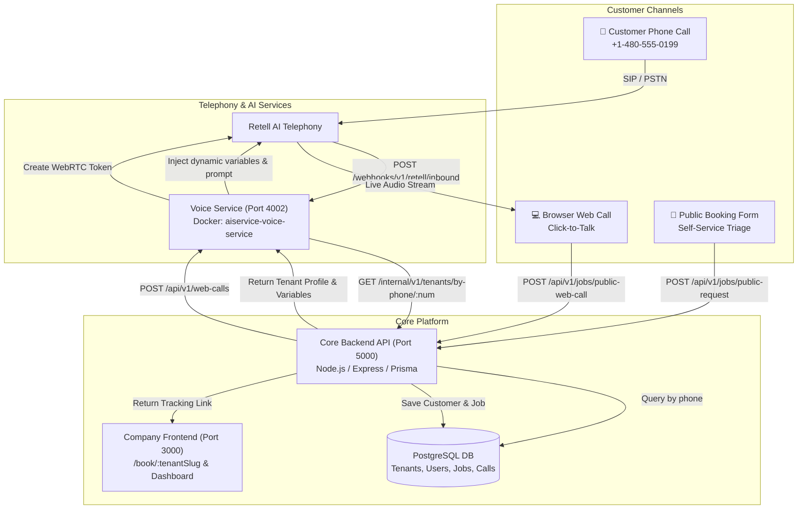

# Multi-Tenancy, Dedicated Telephony & Customer Interaction Guide
**Target Audience:** Engineering Team & Tek Chand  
**System:** Elijah AI Platform  
**Updated:** November 2026

---

## 1. Architecture Overview

Elijah AI is built as a **multi-tenant AI workforce platform** for home service contractors (HVAC, Plumbing, Electrical). Every contractor company is an independent tenant with:
1. **Their Own Subdomain & Branding** (e.g., `vanguard-electric.elijahai.com` or `localhost:3000/book/vanguard-electric`).
2. **Their Own Unique Phone Number** (e.g., `+1-480-555-0199`) mapped to an AI Voice Receptionist.
3. **A Branded Customer Interaction Portal** supporting live in-browser WebRTC AI voice calling, conversational triage, and self-service work order booking.



---

## 2. Multi-Tenant Subdomain Architecture

### A. How Tenant Identification Works
In the PostgreSQL database (`Tenant` table), every contractor has:
- `id`: UUID (e.g., `cmwg840ls0003yeczb8cjhpwn`)
- `slug`: Unique URL-friendly slug (e.g., `vanguard-electric`, `desert-air`, `apex-plumbing`)
- `name`: Display name (e.g., `Vanguard Electric & Power`)
- `phone`: Primary company phone number (e.g., `+14805550199`)
- `tradeType`: `HVAC` | `PLUMBING` | `ELECTRICAL`
- `status`: `ACTIVE` | `SUSPENDED` | `TRIAL`

### B. Routing in Development vs. Production
1. **Development Routing (Path-Based):**
   - Customer Portal: `http://localhost:3000/book/:tenantSlug`
   - Example: `http://localhost:3000/book/vanguard-electric`
   - Contractor Dashboard: User logs in, and the JWT token carries `tenantId` and `tenantSlug`.

2. **Production Routing (Wildcard Subdomains):**
   - DNS Configuration: Set a wildcard CNAME record: `*.elijahai.com` pointing to the frontend load balancer/Vercel.
   - Example URLs:
     - `https://vanguard-electric.elijahai.com` -> Contractor Landing & Booking
     - `https://desert-air.elijahai.com` -> Contractor Landing & Booking
     - `https://app.elijahai.com` -> Contractor Dashboard Login
     - `https://admin.elijahai.com` -> Platform SuperAdmin

3. **Next.js Middleware Subdomain Resolver (`company-frontend/src/middleware.ts`):**
   Tek Chand can activate wildcard subdomain routing with this middleware:

```typescript
import { NextRequest, NextResponse } from 'next/server';

export function middleware(req: NextRequest) {
  const url = req.nextUrl;
  const hostname = req.headers.get('host') || '';

  // Extract subdomain: e.g. "vanguard-electric.elijahai.com" -> "vanguard-electric"
  const currentHost = hostname.replace(`.${process.env.NEXT_PUBLIC_ROOT_DOMAIN}`, '');
  const isCustomSubdomain = currentHost !== hostname && !currentHost.includes('localhost') && currentHost !== 'www';

  if (isCustomSubdomain) {
    // Rewrite root "/" to the branded booking page "/book/[slug]"
    if (url.pathname === '/') {
      return NextResponse.rewrite(new URL(`/book/${currentHost}`, req.url));
    }
  }

  return NextResponse.next();
}

export const config = {
  matcher: ['/((?!api|_next/static|_next/image|favicon.ico).*)'],
};
```

### C. Dynamic Tenant Branding API
When a customer visits `/book/[slug]`, the page fetches tenant branding dynamically:
- **Endpoint:** `GET http://localhost:5000/api/v1/jobs/company/:slug`
- **Controller:** `backend/src/modules/jobs/job.controller.ts -> getCompanyProfile`
- **Response:**
```json
{
  "success": true,
  "data": {
    "id": "cmwg840ls0003yeczb8cjhpwn",
    "name": "Vanguard Electric & Power",
    "slug": "vanguard-electric",
    "tradeType": "ELECTRICAL",
    "phone": "+14805550199",
    "address": "Phoenix, AZ"
  }
}
```

---

## 3. Dedicated Phone Numbers & Inbound Call Routing

### A. How a Tenant Gets a Dedicated Phone Number
1. **SuperAdmin Tenant Provisioning:**
   - Navigates to `superadmin-frontend` (`http://localhost:3001/tenants`).
   - Clicks **"Create Tenant"** (`POST /api/v1/super-admin/tenants`).
   - Inputs Company Name, Trade Type, Slug, and **Assigned Phone Number** (e.g. `+14805550199`).
2. **Telephony Number Allocation:**
   - Numbers are provisioned through Retell AI or Twilio (via Retell's number management API).
   - The inbound webhook for the number is configured in Retell to point to:
     `https://<voice-service-public-url>/webhooks/v1/retell/inbound`

### B. Inbound Call Step-by-Step Execution Flow
When a homeowner calls `+1 (480) 555-0199`:

1. **Retell Inbound Webhook (`voice-service` on port 4002):**
   - Retell detects an incoming call to `+14805550199` and sends a signed POST request to `/webhooks/v1/retell/inbound`.
   - Verified with HMAC signature (`x-retell-signature`).

2. **Tenant Phone Lookup via Internal Microservice API:**
   - `voice-service` executes:
     `GET http://backend:5000/internal/v1/tenants/by-phone/+14805550199`
   - Authenticated with microservice header: `x-internal-service-key`.
   - Located in: `backend/src/modules/internal/internal.controller.ts` -> `getTenantByPhone`.

3. **Backend Database Query:**
   - `backend` executes:
     ```ts
     const tenant = await prisma.tenant.findFirst({
       where: {
         OR: [{ phone: cleanPhone }, { phone: { contains: cleanPhone.slice(-10) } }],
         status: 'ACTIVE',
       },
     });
     ```
   - Returns `{ tenantId, name: "Vanguard Electric & Power", tradeType: "ELECTRICAL", timezone: "America/Phoenix" }`.

4. **Dynamic AI Receptionist Prompt Injection:**
   - `voice-service` retrieves the receptionist voice agent and overrides the prompt variables:
     - `{{business_name}}` -> `"Vanguard Electric & Power"`
     - `{{trade_type}}` -> `"Electrical"`
     - `{{timezone}}` -> `"America/Phoenix"`
     - `{{greeting}}` -> `"Thank you for calling Vanguard Electric & Power! How can we assist you with your electrical service today?"`
   - Retell answers the phone immediately with the contractor's personalized voice persona.

5. **Multi-Tenant Call Logging:**
   - Every audio recording, live transcript turn, customer sentiment, and AI-scheduled work order is stored with `tenantId: tenant.id`.
   - Contractors only see their own calls in `company-frontend` -> **Unified Inbox** (`/inbox`).

---

## 4. Customer Website & Landing Page Interaction

Contractors get a fully interactive public portal located at:
📁 **File:** `company-frontend/src/app/book/[slug]/page.tsx`  
🌐 **Route:** `http://localhost:3000/book/:tenantSlug`

### Channel 1: In-Browser WebRTC AI Voice Calling ("Click-to-Talk")
Homeowners can talk to the contractor's AI receptionist directly through their web browser without picking up a telephone.

- **Component:** `company-frontend/src/components/calling/WebCallWidget.tsx`
- **SDK:** `retell-client-js-sdk` (`RetellWebClient`)
- **How It Works:**
  1. The homeowner clicks **"Talk with AI Receptionist Now"**.
  2. The browser requests microphone access.
  3. Frontend sends `POST http://localhost:5000/api/v1/jobs/public-web-call` with `{ tenantSlug }`.
  4. Backend verifies the tenant, generates an internal service token, and calls `voice-service` (`POST /api/v1/web-calls`).
  5. `voice-service` registers a live session with Retell AI and returns a WebRTC `accessToken`.
  6. The browser initiates two-way streaming audio with ultra-low latency (<600ms).
  7. A live scrolling transcript of the conversation renders on the screen in real-time.
  8. When the AI receptionist gathers the customer's issue, address, and preferred time window, it automatically invokes the `book_service` tool to book the job into the database.

### Channel 2: Self-Service Booking Form & Issue Triage
For customers who prefer typing rather than talking:

- **Quick Issue Presets:**
  - ❄️ *AC Not Cooling*
  - ⚡ *Breaker / Power Out*
  - 💧 *Water Leak*
  - 🔥 *Heating Issue*
  - 🛠️ *Maintenance / Tune-Up*
- **Form Fields:**
  - Homeowner Name, Phone, and Email
  - Street Address, ZIP Code, Gate / Access Code
  - Urgency (`EMERGENCY` | `HIGH` | `NORMAL`)
  - Equipment Brand & Model Number (optional)
  - Preferred Time Window (`Morning 8-12`, `Afternoon 12-4`, `First Available`)
- **Submission:**
  - `POST http://localhost:5000/api/v1/jobs/public-request`
  - Backend creates a `Customer` record (or links to existing by phone), validates service ZIP code, creates a `Job` with status `UNSCHEDULED` (or auto-assigned), and generates a job number (e.g. `JOB-5002`).

### Channel 3: Live Customer Tracking Link
Immediately upon booking (via either Voice or Web Form), the customer receives a confirmation screen and an SMS with a live tracking URL:
- **Route:** `http://localhost:3000/track/:jobId`
- **Component:** `company-frontend/src/app/track/[id]/page.tsx`
- **Live Status Updates:**
  - `SCHEDULED` -> Shows assigned time window and technician profile.
  - `DISPATCHED` / `EN_ROUTE` -> Shows map with technician en route and estimated arrival.
  - `ON_SITE` -> Shows work in progress.
  - `COMPLETED` -> Displays work summary and invoice.

---

## 5. Verification & Testing Playbook for Tek Chand

Tek Chand can verify each flow locally using the commands below:

### Test 1: Check Tenant Subdomain / Slug Lookup
```bash
curl -X GET http://localhost:5000/api/v1/jobs/company/vanguard-electric
```
*Expected: 200 OK with company name, trade type, and phone.*

### Test 2: Check Dedicated Phone Number Lookup
```bash
curl -X GET http://localhost:5000/internal/v1/tenants/by-phone/+14805550199 \
  -H "x-internal-service-key: internal-service-secret-key-elijah-ai-2026"
```
*Expected: 200 OK returning tenant ID and company profile.*

### Test 3: Test Browser WebRTC Call Initialization
```bash
curl -X POST http://localhost:5000/api/v1/jobs/public-web-call \
  -H "Content-Type: application/json" \
  -d '{"tenantSlug": "vanguard-electric"}'
```
*Expected: 201 Created returning `accessToken` and `retellCallId`.*

### Test 4: Open Public Landing Page in Browser
- Open `http://localhost:3000/book/vanguard-electric` in Google Chrome.
- Test both the **"Talk to AI Receptionist"** WebRTC button and the **Self-Service Booking Form**.
